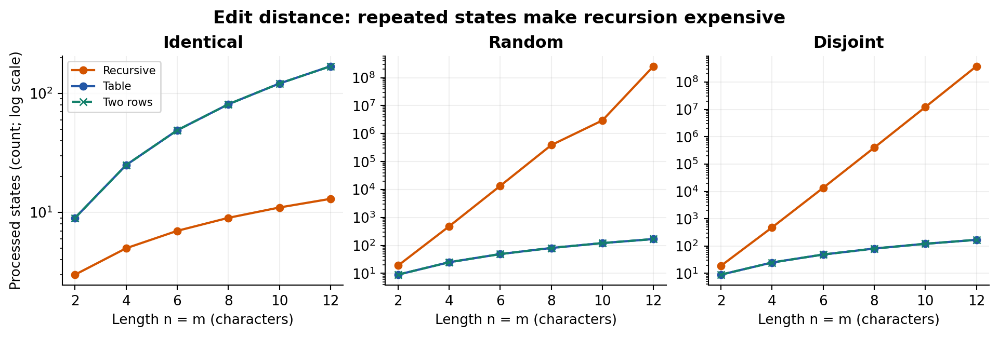
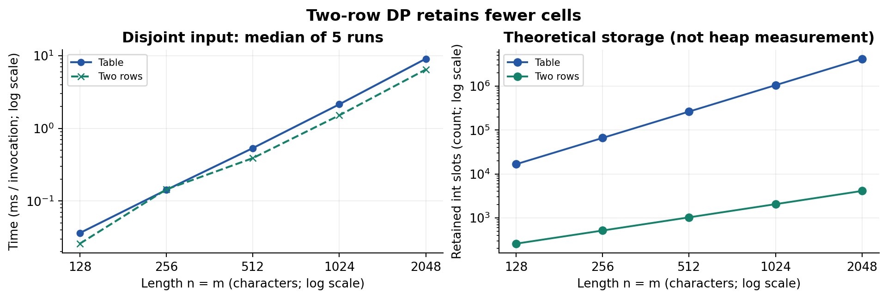
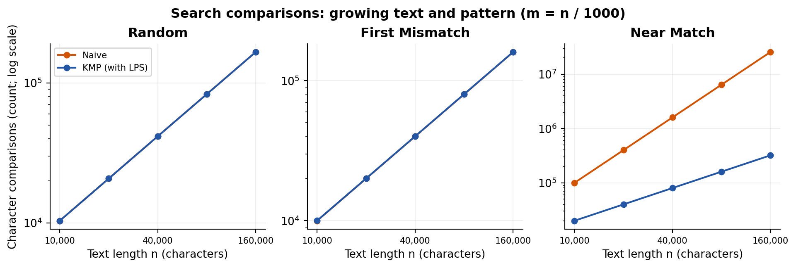
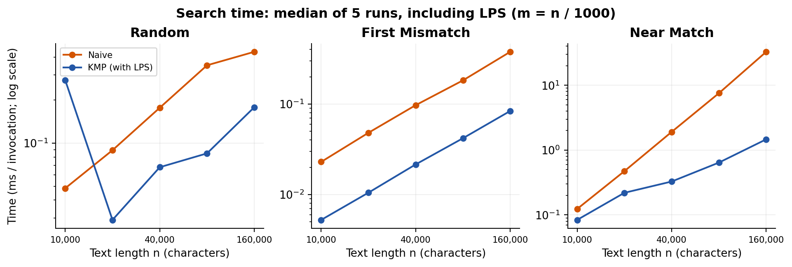

# City Search & Spell-Check - Assignment 4

Java 17 | 7 November 2026

## Experiment Design Card

Recorded in EXPERIMENT_PLAN.md and committed before the first benchmark.

| Field | Design |
| --- | --- |
| Question | Edit: how do recursion and DP change work growth and retained storage? Search: which inputs let KMP avoid the repeated comparisons made by Naive? |
| Sizes | All edit versions: n = m = 2, 4, 6, 8, 10, 12. Extra table/two-row runs: n = m = 128, 256, 512, 1024, 2048. Search: n = 10000, 20000, 40000, 80000, 160000; m = n/1000. Every range spans at least 4x. Recursion is capped at 12 to keep runtime practical. |
| Inputs | Edit: identical seeded strings show the matching shortcut; independent random strings (a..z) show a less regular case; a^n vs b^n forces recursive branching. Search: random text with a middle substring guarantees a match; a^n vs b^m rejects immediately; a^n vs a^(m-1)b forces a late mismatch at every Naive alignment. |
| Metrics | Elapsed milliseconds per invocation, median of 5 runs. Edit state_visits counts each call or evaluated DP state, including bases. Search counts actual character comparisons, separating LPS from scanning; totals and timings include both. Each counter increments inside the Java algorithm. Storage plots count theoretical int slots, not heap usage. |
| Prediction | Disjoint recursion grows exponentially; identical recursion needs n+1 calls. DP performs (n+1)^2 state evaluations, but two rows retain only 2(n+1) int slots. Near-match Naive work grows approximately quadratically because m grows with n; KMP remains linear in n+m. Random and first-mismatch search should be near-linear. |
| Plots | 1: small edit states (log y) reveals repeated work. 2: large DP time and theoretical slots shows the time/space tradeoff. 3: search comparisons isolates repeated character work. 4: search time checks whether clock measurements support the counter trend. Search panels use log axes. |

Seed 20261107. Each case has 2 warmup batches and 5 measured batches. Short calls are batched; time_ms is batch_time_ms / batch_iterations. CSV counters are per invocation, not batch totals. Inputs, validation and file writing are outside the timer; result checks prevent silent mismatches. The full batch schedule was recorded in EXPERIMENT_PLAN.md before the first run.

Plan changes: no sizes, inputs, counters or predictions changed. An initial Java 21 run was replaced by a complete Java 17 run to match the project's target; only the latter is reported. Fixed inputs, hashes, answers and counters are reproducible; elapsed time cannot be identical across runs or computers.

Validation: 12 JUnit 5 tests passed with zero failures, errors or skips. These include all supplied distance, LPS and search references, empty/overlong cases, counter resets, 100 random edit pairs and 100 random search cases (also checked with String.indexOf). All 570 measured CSV rows passed consistency checks.

## Edit distance results

Disjoint recursion reaches 377,393,953 calls at n=12, while either DP method evaluates only 169 states; identical recursion uses 13 calls.

At n=2048, two rows retain 4,098 int slots versus 4,198,401 for the table; their disjoint medians are 6.443 ms and 9.068 ms, respectively.

| Disjoint edit case | Median time (ms) | State visits |
| --- | --- | --- |
| Recursive, n=12 | 1091.879 | 377,393,953 |
| Table, n=2048 | 9.068 | 4,198,401 |
| Two rows, n=2048 | 6.443 | 4,198,401 |

Times are medians of five runs; rows with different n are not equal-size timing comparisons.

## String search results

For n=160,000 and m=160 on near-match input, Naive makes 25,574,560 comparisons versus 320,158 for KMP, about 79.9 times as many.

At the largest near-match case, Naive takes 32.766 ms and KMP 1.465 ms (22.4x measured speedup); timing ratios need not equal comparison ratios.

| Input, n=160000; m=160 | Naive (ms) | KMP (ms) |
| --- | --- | --- |
| random | 0.435 | 0.178 |
| first_mismatch | 0.377 | 0.084 |
| near_match | 32.766 | 1.465 |

KMP includes LPS construction in both time and total comparisons.

## Prediction vs result

**Edit distance.** Expected: repeated disjoint recursion should grow much faster than DP, and two rows should save space. Observed: at n=12 recursion made 377,393,953 calls, while both DP variants made 169 state evaluations. At n=2048 both DP variants evaluated 4,198,401 states; two rows were faster on this run and used 1,024.5 times fewer retained int slots. This agrees with the predicted work/space trend, but state counts are not CPU instructions and smaller-case timing irregularities are compatible with JIT, allocation and shared-host noise.

**String search.** Expected: long repeated prefixes should make Naive expensive while KMP reuses prefix information. Observed: the near-match counter ratio reached 79.9x and the time ratio 22.4x at the largest case. Random and first-mismatch comparison curves nearly overlap between algorithms and grow roughly linearly. Time does not track comparisons exactly because preprocessing, branches, loop overhead and JVM optimization differ; the experiment does not establish a universal speed ranking. KMP's random-input time drops from n=10000 to n=20000 despite more comparisons; incomplete JVM warmup or host noise is a plausible explanation, not improved asymptotic complexity.

## Short answers

### Which input made string search slowest, and why?

The largest near_match input was the slowest measured case for both implementations: text a^160000 and pattern a^159b. Naive matches a long prefix and then fails on b at every alignment, so it repeats almost the same work (n-m+1) times. It performs 25,574,560 character comparisons. KMP uses LPS to fall back within the pattern without moving backwards in the text, so its work stays O(n+m), although this case still causes extra fallback comparisons.

### How large an n could recursive edit distance handle, and what stopped it?

The largest tested length was n=m=12, and the disjoint case completed with a median of 1091.879 ms per invocation. That call already visited 377,393,953 recursive states. The predeclared experiment budget stopped further sizes because mismatches create three branches and repeated work grows exponentially. This is the largest measured size, not a proven hardware limit; identical strings are much easier, and no timeout or stack overflow was observed.

### What do two rows gain and lose compared with the full table?

Two rows reduce auxiliary DP storage from O(n*m) to O(m), while preserving the same distance and O(n*m) time. At n=m=2048, the implementation retains 4,098 integer slots instead of 4,198,401, excluding array headers and input strings. It discards previous rows, so a direct traceback of the edit sequence is no longer available. Recovering the operations needs recomputation or another technique; using two rows alone does not guarantee a time speedup.

## Environment and limitations

Scope: Java 17.0.21 on Linux amd64, AMD EPYC 9V74, single-threaded, -Xms128m -Xmx512m. One deterministic input per type/size is repeated five times; this is a teaching experiment, not JMH or a distribution of inputs. Counters add overhead, algorithm order is fixed, and sub-microsecond results are noisy. Search grows m with n; with a fixed m, Naive's O(n*m) bound is linear in n. Strings use case-sensitive Java UTF-16 char units, with no normalization or case folding.

Data: results/results.csv (570 runs); results/summary.csv (114 medians). Full environment: results/environment.txt.

Sources: assignment's supplied reference values and standard recurrences described in its specification; no external benchmark data used.
